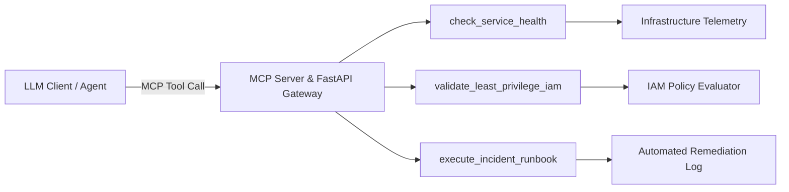

# MCP Cloud & DevOps Operations Copilot

[](https://www.python.org/)
[](https://modelcontextprotocol.io/)
[](https://fastapi.tiangolo.com/)
[](https://www.docker.com/)
[](LICENSE)

A **Model Context Protocol (MCP)** powered **Cloud & DevOps Operations Copilot** built with **Python**, **FastAPI**, and **Docker**. It exposes standardized MCP tools for infrastructure health monitoring, least-privilege IAM policy validation, and automated incident runbook execution.

---

## Architecture



## MCP Tools Exposed

- `check_service_health`: Evaluates CPU, memory, and endpoint latency against production thresholds.
- `validate_least_privilege_iam`: Audits IAM role JSON policies for wildcard actions (`*`) or missing MFA conditions.
- `execute_incident_runbook`: Runs safe, idempotent remediation steps (cache flush, service restart, alert escalation).

## Project Structure

```text
mcp-cloud-devops-copilot/
├── .github/workflows/ci.yml   # Automated pytest CI
├── src/
│   ├── __init__.py
│   ├── config.py              # Threshold & environment settings
│   ├── models.py              # Pydantic request/response schemas
│   ├── mcp_server.py          # MCP tool registry & DevOps handlers
│   └── main.py                # FastAPI + MCP tool router
├── tests/
│   └── test_copilot.py        # Unit tests for MCP DevOps tools
├── .env.example
├── .gitignore
├── Dockerfile
├── docker-compose.yml
├── LICENSE
└── requirements.txt
```

## Quickstart

### 1. Local Setup
```bash
git clone https://github.com/nazmulahmedsolaiman/mcp-cloud-devops-copilot.git
cd mcp-cloud-devops-copilot
python -m venv .venv
source .venv/bin/activate  # On Windows: .venv\Scripts\activate
pip install -r requirements.txt
cp .env.example .env
uvicorn src.main:app --reload
```

### 2. Docker Compose
```bash
docker compose up --build
```
Open Swagger UI at `http://localhost:8000/docs`.

## Running Tests
```bash
python -m pytest -v
```
